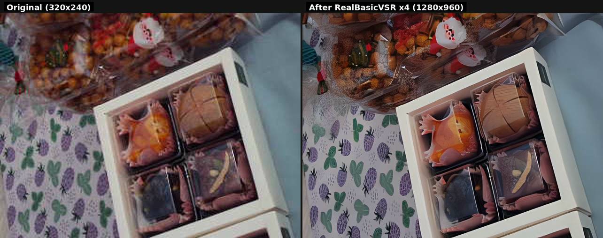

# 영상보정 (RealBasicVSR 원클릭 설치)

오래된 저화질 영상을 AI로 4배 해상도로 선명하게 복원합니다.
[RealBasicVSR](https://github.com/ckkelvinchan/RealBasicVSR) (CVPR 2022, Apache-2.0) 모델을 윈도우에서 설치 없이 가깝게, 더블클릭과 드래그만으로 쓸 수 있게 만든 래퍼입니다.

## 결과 예시

같은 영상의 같은 장면입니다. 왼쪽은 320x240 원본을 그대로 확대한 것, 오른쪽은 이 도구로 1280x960으로 복원한 결과입니다.

## 필요 사양

- Windows 64비트
- NVIDIA 그래픽카드 (VRAM 6GB 이상 권장, 8GB 기준 기본 설정 포함)
- 여유 공간 약 10GB
- 인터넷 연결 (첫 설치 때 약 3GB 다운로드)

## 설치 (처음 한 번, 10~40분)

1. [Miniconda](https://docs.conda.io/en/latest/miniconda.html)를 설치합니다. (Windows 64-bit 설치 파일, 기본 설정 그대로)
2. 이 저장소의 `install.bat`을 다운로드해서 더블클릭합니다.
   - "Windows의 PC 보호" 경고가 뜨면 **추가 정보 → 실행**을 누릅니다.
   - Miniconda 경로는 자동으로 찾고, 못 찾으면 한 번만 물어봅니다.
3. 마지막에 `[완료] cuda: True + SELFTEST ALL OK`가 보이면 성공입니다.

설치가 끝나면 자동으로 아래가 준비됩니다.

- 파이썬 환경 (conda env `rbvsr`)
- GPU판 PyTorch (검증된 2.14.1+cu130)
- 복원 프로그램과 AI 가중치 (245MB, OpenMMLab 공식 배포본)
- 자가진단 통과 확인

## 사용법

1. 이 저장소의 `영상보정.bat`을 다운로드해서 바탕화면에 둡니다.
2. 복원할 영상 파일을 `영상보정.bat` 아이콘 위로 끌어다 놓습니다.
   - 여러 개를 한꺼번에 끌어다 놓으면 순서대로 전부 처리합니다.
3. 결과는 원본과 **같은 폴더**에 `원본이름_영상보정.mp4`로 생깁니다. 원본은 바뀌지 않습니다.
4. 전부 끝나면 성공/실패 개수가 표시됩니다.

주의: 결과 영상에는 소리가 없습니다. 소리가 필요하면 편집 프로그램에서 원본 음성을 얹어 주세요.

## 전후 비교 GIF 만들기

1. 이 저장소의 `비교GIF.bat`을 다운로드해서 바탕화면에 둡니다.
2. 원본 영상을 `비교GIF.bat` 위로 끌어다 놓습니다. (원본+보정본 두 개를 같이 놓아도 됩니다)
3. 원본과 같은 폴더에 `원본이름_비교.gif`가 생깁니다. 왼쪽이 원본, 오른쪽이 보정본입니다. (앞 8초, 20MB가 넘으면 자동으로 더 작게 만듭니다)

## 문제 해결

- **`cuda: False`가 뜨면 (GPU 인식 실패)**: `fix-gpu.bat`을 더블클릭해서 GPU판 PyTorch로 교체합니다.
- **메모리 부족(CUDA out of memory)**: `영상보정.bat` 안의 `--max-seq-len 40` 숫자를 20으로 줄여 보세요. (해상도가 큰 영상일수록 더 작게)
- **설치 중 오류**: 검은 창 화면을 캡처해서 이슈에 올려 주세요.

## 청크 길이 참고 (VRAM 8GB 기준)

| 원본 해상도 | 권장 --max-seq-len |
|---|---|
| 320x240 | 40 (기본값) |
| 640x480 이하 | 20 |
| 1280x720 | 8 |
| 1920x1080 | 3~4 |

## 크레딧과 라이선스

- 모델: [RealBasicVSR](https://github.com/ckkelvinchan/RealBasicVSR) - Kelvin C.K. Chan et al., "Investigating Tradeoffs in Real-World Video Super-Resolution", CVPR 2022
- 코드 일부: [open-mmlab/mmagic](https://github.com/open-mmlab/mmagic) (`rbvsr_standalone.py`에 포함, Apache-2.0)
- 가중치: OpenMMLab 공식 배포본을 설치 시 자동 다운로드
- 이 저장소의 라이선스: Apache License 2.0 (LICENSE, NOTICE 참고)
